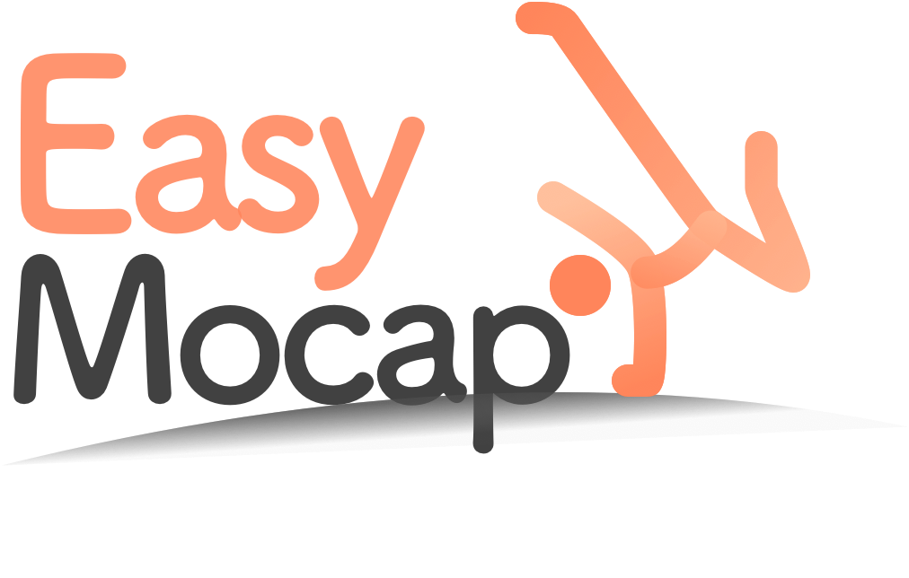
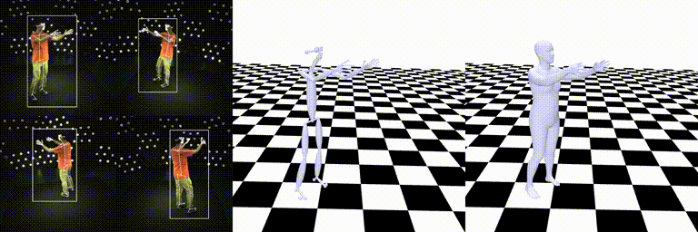
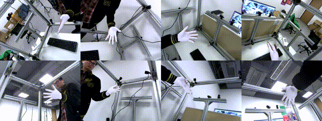
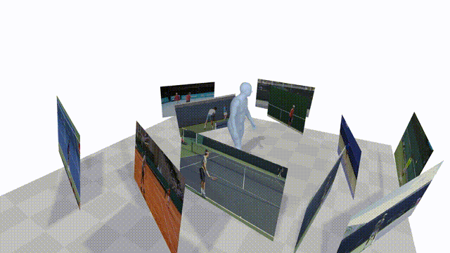
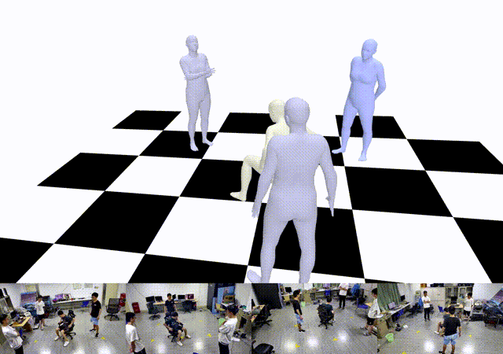
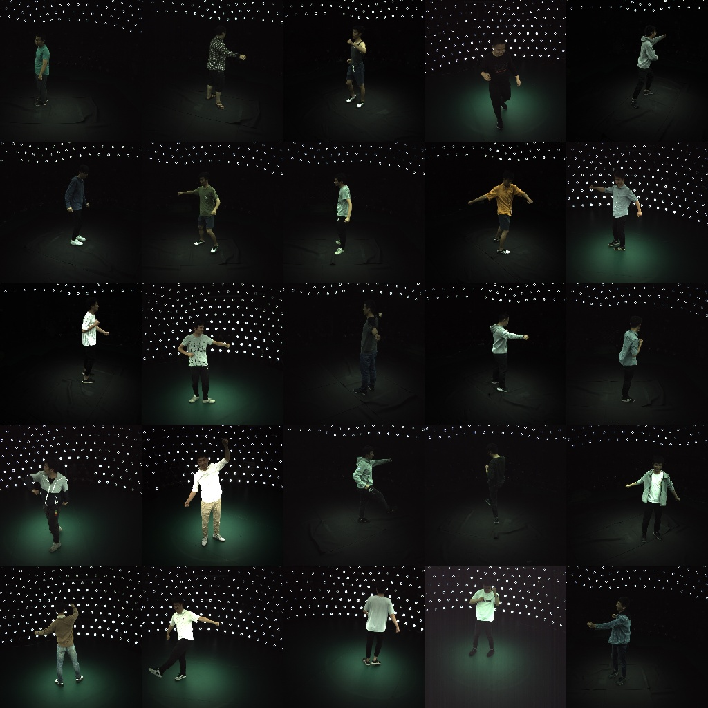

# 8 路 RGB 多视角人体姿态重建

基于 [EasyMocap](https://github.com/zju3dv/EasyMocap) 构建的多相机 3D 人体姿态重建与数据处理项目，面向肢体缺陷人群的 3D 人体建模和数据标注需求。项目围绕 8 路 RGB 视频的同步采集、相机标定、2D 关键点提取、鲁棒 3D 三角化及 SMPL 参数拟合，优化了异常视角和低质量关键点对重建结果的影响。

**技术栈：** Python、OpenCV、ViTPose、HRNet、EasyMocap、SMPL、Bundle Adjustment（BA）

## 核心工作（简历重点）

以下四项是对项目工作的概括，便于快速展示；仓库还包含下文列出的同步、异常相机处理与质量诊断等工程优化。

| 阶段 | 方法与实现 | 主要产物 |
| --- | --- | --- |
| 多相机标定与 2D 姿态估计 | 对 8 路 RGB 视频进行同步处理和相机内外参标定；结合 PnP-RANSAC 与 BA 优化相机参数，并使用 ViTPose / HRNet 提取 2D 关键点。相关入口：[同步切片](tools_sync_split_videos.py)、[棋盘格外参 BA](apps/calibration/calib_chessboard_extri_ba.py)、[外参精修](tools_refine_extri_from_chessboard_video.py)。 | 对齐的多视角帧、相机参数、2D 关键点 |
| 鲁棒多视角三角化 | 在 EasyMocap 关键点重建流程上加入置信度阈值、重投影误差筛选和至少两个有效视角的约束，过滤异常观测并恢复 3D 关节坐标。实现见 [鲁棒三角化脚本](tools_triangulate_robust_from_pkl.py)。 | BODY25 3D 关键点、逐帧质量报告与重投影预览 |
| SMPL 参数拟合 | 调整 2D / 3D 关键点拟合损失权重，结合关节置信度和异常关键点 Mask 减少错误观测的影响；输出姿态参数、3D 骨架及人体 Mesh。相关入口：[拟合配置](config/fit/mv1p3d.yml)、[拟合模块](easymocap/multistage/lossbase.py)、[Mesh 序列渲染](tools_render_smpl_mesh_sequence.py)。 | SMPL 参数、3D 骨架、Mesh 可视化 |
| 数据集与质量评估 | 组织多视角 RGB、2D / 3D 关键点、相机参数与 SMPL 结果，并进行数据划分和重建质量检查。相关入口：[重投影评估](tools_eval_reproj_report.py)、[3D 重投影检查](tools_check_mocap_reproject.py)。 | 可供后续单目 3D 人体姿态估计训练与评估的数据基础 |

## 其他工程优化

- **多相机时间同步：** 除按预设时间偏移切片外，支持从视频时间戳秒数变化、音频峰值或可视事件寻找同步锚点，再利用 2D 关键点重投影误差细化各相机帧偏移。相关工具：[时间戳检测](tools_detect_timestamp_rollover.py)、[同步事件查找](tools_find_sync_event.py)、[帧偏移优化](tools_refine_sync_offsets_pkl.py)。
- **倒置视角与人物筛选：** 对倒置相机画面先旋转 180° 进行 2D 姿态检测，再把关键点映射回原图坐标；对单人序列结合框面积、置信度与相邻帧 IoU 筛选目标。相关工具：[倒置视角关键点提取](apps/preprocess/extract_keypoints_upright.py)、[单人关键点筛选](apps/preprocess/filter_keypoints2d_single_person.py)。
- **遮挡相机与标定一致性：** 对棋盘格被遮挡的视角，利用其他已标定相机估计棋盘格世界位姿，再通过跨帧角点筛选与 PnP-RANSAC 求解外参；同时检查图像流与相机参数的对应关系，并支持将外参坐标系转换至棋盘格原点。相关工具：[遮挡视角外参求解](tools_solve_d08_from_others.py)、[相机匹配矩阵](tools_camera_extri_matching_matrix.py)、[坐标系重置](tools_rebase_extri_to_chessboard.py)。
- **重建质量可视化：** 将 3D 骨架或 SMPL Mesh 投影回各视角 RGB 画面，定位相机、关键点及拟合结果中的异常，并输出三角化质量统计。相关工具：[骨架重投影检查](tools_check_mocap_reproject.py)、[多视角 Mesh 叠加](tools_overlay_smpl_on_multiview.py)、[三角化报告](tools_triangulate_robust_from_pkl.py)。

## 项目结果

- 在简历所述的 8 相机实验中，相机参数优化后的整体 RMS 重投影误差达到 **1.05 px**。
- 修复倒置相机视角后，该视角的人员检出量最高提升约 **13 倍**。
- 对低置信度及重投影异常的观测进行筛选，改进了多视角 3D 关节恢复和后续 SMPL 拟合的输入质量。

上述数值来自项目实验记录，依赖对应的采集视频、标注和评测设置；本仓库未包含完整原始数据，因此不能仅凭仓库代码复现这些数值。

## 处理流程与仓库内容

```text
8 路 RGB 视频 → 时间同步 / 抽帧 → 内外参标定 → 2D 关键点
                                            ↓
                          异常视角筛选 / 鲁棒三角化 → 3D 骨架
                                                        ↓
                                              SMPL 拟合 → Mesh / 质量评估
```

- `apps/calibration/`：相机标定与 BA 优化。
- `tools_*.py`：本项目的同步、标定、三角化、评估及可视化工具；多数脚本可通过 `python <脚本名> --help` 查看参数。
- `config/fit/`、`easymocap/`、`myeasymocap/`：EasyMocap 拟合配置及处理模块。
- `doc/quickstart.md`：上游 EasyMocap 的基础使用说明。

视频、标定采集素材、模型权重及运行输出未随仓库上传，需根据自己的相机和数据路径准备。依赖安装与模型准备请参考[上游安装文档](https://chingswy.github.io/easymocap-public-doc/install/install.html)。

## 来源与许可

本仓库是在浙江大学 3D Vision Group 的 [EasyMocap](https://github.com/zju3dv/EasyMocap) 基础上进行的项目开发；下方保留原项目 README，作者与论文引用信息见原文。使用与再分发请遵守仓库中的 [LICENSE](LICENSE)。

---

## 原版 EasyMocap README

<!--
 * @Date: 2021-01-13 20:32:12
 * @Author: Qing Shuai
 * @LastEditors: Qing Shuai
 * @LastEditTime: 2022-11-03 13:09:58
 * @FilePath: /EasyMocapRelease/Readme.md
-->

<div align="center">
    
</div>

**EasyMocap** is an open-source toolbox for **markerless human motion capture** and **novel view synthesis** from RGB videos. In this project, we provide a lot of motion capture demos in different settings.


## News

- :tada: Our SIGGRAPH 2022 [**Novel View Synthesis of Human Interactions From Sparse Multi-view Videos**](https://chingswy.github.io/easymocap-public-doc/works/multinb.html) is released! Check the [documentation](https://chingswy.github.io/easymocap-public-doc/works/multinb.html).
- :tada: EasyMocap v0.2 is released! We support motion capture from Internet videos. Please check the [Quick Start](https://chingswy.github.io/easymocap-public-doc/quickstart/quickstart.html) for more details.


---

## Core features

### Multiple views of a single person

[](./doc/quickstart.md) [](https://colab.research.google.com/drive/1Cyvu_lPFUajr2RKt6yJIfS3HQIIYl6QU?usp=sharing)

This is the basic code for fitting SMPL[^loper2015]/SMPL+H[^romero2017]/SMPL-X[^pavlakos2019]/MANO[^romero2017] model to capture body+hand+face poses from multiple views.

<div align="center">
    
    <br>
    
    <br>
    <sup>Videos are from ZJU-MoCap, with 23 calibrated and synchronized cameras.</sup>
</div>

<div align="center">
    
    <br>
    <sup>Captured with 8 cameras.</sup>
</div>

### Internet video

This part is the basic code for fitting SMPL[^loper2015] with 2D keypoints estimation[^cao2018][^hrnet] and CNN initialization[^kolotouros2019].

<div align="center">
    
    <br>
    <sup>The raw video is from <a href="https://www.youtube.com/watch?v=23EfsN7vEOA">Youtube</a>.</sup>
</div>

### Internet video with a mirror

[](https://arxiv.org/pdf/2104.00340.pdf) [](https://github.com/zju3dv/Mirrored-Human)

<div align="center">
    
    <br>
    <sup>The raw video is from <a href="https://www.youtube.com/watch?v=KOCJJ27hhIE">Youtube</a>.</sup>
</div>


### Multiple Internet videos with a specific action (Coming soon)

[](https://arxiv.org/pdf/2008.07931.pdf) [](./doc/todo.md)

<div align="center">
    <br/>
    <sup>Internet videos of Roger Federer's serving</sup>
</div>

### Multiple views of multiple people

[](https://arxiv.org/pdf/1901.04111.pdf) [](./doc/mvmp.md)

<div align="center">
    <br/>
    <sup>Captured with 8 consumer cameras</sup>
</div>

### Novel view synthesis from sparse views
[](https://arxiv.org/pdf/2012.15838.pdf) [](https://github.com/zju3dv/neuralbody)

<div align="center">
    <br/>
    <sup>Novel view synthesis for chanllenge motion(coming soon)</sup>
</div>

<div align="center">
    <br/>
    <sup>Novel view synthesis for human interaction</sup>
</div>

    
## ZJU-MoCap

With our proposed method, we release two large dataset of human motion: LightStage and Mirrored-Human. See the [website](https://chingswy.github.io/Dataset-Demo/) for more details.

If you would like to download the ZJU-Mocap dataset, please sign the [agreement](https://pengsida.net/project_page_assets/files/ZJU-MoCap_Agreement.pdf), and email it to Qing Shuai (s_q@zju.edu.cn) and cc Xiaowei Zhou (xwzhou@zju.edu.cn) to request the download link.

<div align="center">
<div align="center" width="40%">
    <br/>
    <sup>LightStage: captured with LightStage system</sup>
</div>
<div align="center" width="40%">
    <br/>
    <sup>Mirrored-Human: collected from the Internet</sup>
</div>
</div>

Many works have achieved wonderful results based on our dataset:

- [Real-time volumetric rendering of dynamic humans](https://real-time-humans.github.io/)
- [CVPR2022: HumanNeRF: Free-viewpoint Rendering of Moving People from Monocular Video](https://grail.cs.washington.edu/projects/humannerf/)
- [ECCV2022: KeypointNeRF: Generalizing Image-based Volumetric Avatars using Relative Spatial Encoding of Keypoints](https://markomih.github.io/KeypointNeRF/)
- [SIGGRAPH 2022 paper Drivable Volumetric Avatars using Texel-Aligned Features](https://github.com/facebookresearch/dva)

## Other features

### 3D Realtime visualization
[](./doc/realtime_visualization.md)
<div align="center">
    
    
    
</div>

<div align="center">
    
    
    
</div>

### [Camera calibration](apps/calibration/Readme.md)

<div align="center">
    
    
    <br>
    <sup>Calibration for intrinsic and extrinsic parameters</sup>
</div>

### [Annotator](apps/annotation/Readme.md)

<div align="center">
    
    
    <br>
    <sup>Annotator for bounding box, keypoints and mask</sup>
</div>


## Updates
- 11/03/2022: Support MultiNeuralBody.
- 12/25/2021: Support mediapipe keypoints detector.
- 08/09/2021: Add a colab demo [here](https://colab.research.google.com/drive/1Cyvu_lPFUajr2RKt6yJIfS3HQIIYl6QU?usp=sharing).
- 06/28/2021: The **Multi-view Multi-person** part is released!
- 06/10/2021: The **real-time 3D visualization** part is released!
- 04/11/2021: The calibration tool and the annotator are released.
- 04/11/2021: **Mirrored-Human** part is released.

## Installation

See [documentation](https://chingswy.github.io/easymocap-public-doc/install/install.html) for more instructions.

## Acknowledgements

Here are the great works this project is built upon:

- SMPL models and layer are from MPII [SMPL-X model](https://github.com/vchoutas/smplx).
- Some functions are borrowed from [SPIN](https://github.com/nkolot/SPIN), [VIBE](https://github.com/mkocabas/VIBE), [SMPLify-X](https://github.com/vchoutas/smplify-x)
- The method for fitting 3D skeleton and SMPL model is similar to [SMPLify-X](https://github.com/vchoutas/smplify-x)(with 3D keypoints loss), [TotalCapture](http://www.cs.cmu.edu/~hanbyulj/totalcapture/)(without using point clouds).
- We integrate some easy-to-use functions for previous great work:
  - `easymocap/estimator/mediapipe_wrapper.py`: [MediaPipe](https://github.com/google/mediapipe)
  - `easymocap/estimator/SPIN`  : an SMPL estimator[^cao2018]
  - `easymocap/estimator/YOLOv4`: an object detector[^kolotouros2019]
  - `easymocap/estimator/HRNet` : a 2D human pose estimator[^bochkovskiy2020]

## Contact

Please open an issue if you have any questions. We appreciate all contributions to improve our project.
    

## Contributor

EasyMocap is **built by** researchers from the 3D vision group of Zhejiang University: [**Qing Shuai**](https://chingswy.github.io/), [**Qi Fang**](https://raypine.github.io/), [**Junting Dong**](https://jtdong.com/), [**Sida Peng**](https://pengsida.net/), **Di Huang**, [**Hujun Bao**](http://www.cad.zju.edu.cn/home/bao/), **and** [**Xiaowei Zhou**](https://xzhou.me/). 

We would like to thank Wenduo Feng, Di Huang, Yuji Chen, Hao Xu, Qing Shuai, Qi Fang, Ting Xie, Junting Dong, Sida Peng and Xiaopeng Ji who are the performers in the sample data. We would also like to thank all the people who has helped EasyMocap [in any way](https://github.com/zju3dv/EasyMocap/graphs/contributors).

## Citation

This project is a part of our work [iMocap](https://zju3dv.github.io/iMoCap/), [Mirrored-Human](https://zju3dv.github.io/Mirrored-Human/), [mvpose](https://zju3dv.github.io/mvpose/), [Neural Body](https://zju3dv.github.io/neuralbody/), [MultiNeuralBody](https://chingswy.github.io/easymocap-public-doc/works/multinb.html), [enerf]().

Please consider citing these works if you find this repo is useful for your projects.

```bibtex
@Misc{easymocap,  
    title = {EasyMoCap - Make human motion capture easier.},
    howpublished = {Github},  
    year = {2021},
    url = {https://github.com/zju3dv/EasyMocap}
}

@inproceedings{shuai2022multinb,
  title={Novel View Synthesis of Human Interactions from Sparse
Multi-view Videos},
  author={Shuai, Qing and Geng, Chen and Fang, Qi and Peng, Sida and Shen, Wenhao and Zhou, Xiaowei and Bao, Hujun},
  booktitle={SIGGRAPH Conference Proceedings},
  year={2022}
}

@inproceedings{lin2022efficient,
  title={Efficient Neural Radiance Fields for Interactive Free-viewpoint Video},
  author={Lin, Haotong and Peng, Sida and Xu, Zhen and Yan, Yunzhi and Shuai, Qing and Bao, Hujun and Zhou, Xiaowei},
  booktitle={SIGGRAPH Asia Conference Proceedings},
  year={2022}
}

@inproceedings{dong2021fast,
  title={Fast and Robust Multi-Person 3D Pose Estimation and Tracking from Multiple Views},
  author={Dong, Junting and Fang, Qi and Jiang, Wen and Yang, Yurou and Bao, Hujun and Zhou, Xiaowei},
  booktitle={T-PAMI},
  year={2021}
}
    
@inproceedings{dong2020motion,
  title={Motion capture from internet videos},
  author={Dong, Junting and Shuai, Qing and Zhang, Yuanqing and Liu, Xian and Zhou, Xiaowei and Bao, Hujun},
  booktitle={European Conference on Computer Vision},
  pages={210--227},
  year={2020},
  organization={Springer}
}

@inproceedings{peng2021neural,
  title={Neural Body: Implicit Neural Representations with Structured Latent Codes for Novel View Synthesis of Dynamic Humans},
  author={Peng, Sida and Zhang, Yuanqing and Xu, Yinghao and Wang, Qianqian and Shuai, Qing and Bao, Hujun and Zhou, Xiaowei},
  booktitle={CVPR},
  year={2021}
}

@inproceedings{fang2021mirrored,
  title={Reconstructing 3D Human Pose by Watching Humans in the Mirror},
  author={Fang, Qi and Shuai, Qing and Dong, Junting and Bao, Hujun and Zhou, Xiaowei},
  booktitle={CVPR},
  year={2021}
}

```

[^loper2015]: Loper, Matthew, et al. "SMPL: A skinned multi-person linear model." ACM transactions on graphics (TOG) 34.6 (2015): 1-16.

[^romero2017]: Romero, Javier, Dimitrios Tzionas, and Michael J. Black. "Embodied hands: Modeling and capturing hands and bodies together." ACM Transactions on Graphics (ToG) 36.6 (2017): 1-17.

[^pavlakos2019]: Pavlakos, Georgios, et al. "Expressive body capture: 3d hands, face, and body from a single image." Proceedings of the IEEE/CVF Conference on Computer Vision and Pattern Recognition. 2019.

<!-- [4] Bogo, Federica, et al. "Keep it SMPL: Automatic estimation of 3D human pose and shape from a single image." European conference on computer vision. Springer, Cham, 2016. -->

[^cao2018]: Cao, Z., Hidalgo, G., Simon, T., Wei, S.E., Sheikh, Y.: Openpose: real-time multi-person 2d pose estimation using part affinity fields. arXiv preprint arXiv:1812.08008 (2018)

[^kolotouros2019]: Kolotouros, Nikos, et al. "Learning to reconstruct 3D human pose and shape via model-fitting in the loop." Proceedings of the IEEE/CVF International Conference on Computer Vision. 2019

[^bochkovskiy2020]: Bochkovskiy, Alexey, Chien-Yao Wang, and Hong-Yuan Mark Liao. "Yolov4: Optimal speed and accuracy of object detection." arXiv preprint arXiv:2004.10934 (2020).

[^hrnet]: Sun, Ke, et al. "Deep high-resolution representation learning for human pose estimation." Proceedings of the IEEE/CVF Conference on Computer Vision and Pattern Recognition. 2019.
